# Марафон MetaLabs · Мини-шоп с заказами в Telegram

За 6 часов вы с нуля сделаете сайт кофейни **Zerno**: красивый первый экран, меню с поиском и фильтром, корзину, которая не пропадает после F5, форму заказа — и заказ **сам прилетит в Telegram**. В конце сайт будет в интернете, а ссылка — в вашем портфолио.

Можно сразу сделать **свою тему** (цветы, кроссовки, пекарня, мерч) — структура та же, меняются название, цвета, товары и картинки. Если не успеваете — оставьте кофейню и поменяйте название и цвета в конце.

**Правила марафона**
- Работаем по этапам. После каждого этапа — сверка с фото и коммит в git.
- Отстали? Ничего страшного: у преподавателя есть архив «как должно быть после этапа N» — берёте его и идёте дальше со всеми.
- Код пишем сами. В этом файле — только задания: что сделать, зачем и как проверить.
- Готовые файлы не трогаем: `js/products.js` (данные), `api/order.js` (отправка в Telegram), `server.js` (локальный сервер), картинки в `assets/`.

---

## Этап 0 · Старт (0:00–0:20)

**Что:**
1. Распакуйте архив, откройте папку в VS Code.
2. В терминале: `npm start` → откройте `http:/localhost:3000`. Пока страница пустая — это нормально. (Нужен Node.js 20.12 или новее: `node -v`.)
3. `git init`, первый коммит «Старт марафона».
4. Посмотрите `js/products.js` — там уже есть название магазина, контакты, категории и 14 товаров с картинками. Это наша «база данных».

**Зачем:** сервер нужен, потому что в конце сайт будет отправлять заказ на `/api/order`. Открывать `index.html` двойным кликом нельзя — заказ не уйдёт.

**Проверка:** в терминале `Магазин: http://localhost:3000`, в браузере — белая страница без ошибок в консоли (F12).

---

## Этап 1 · Шапка и первый экран (0:20–1:20) · HTML + CSS

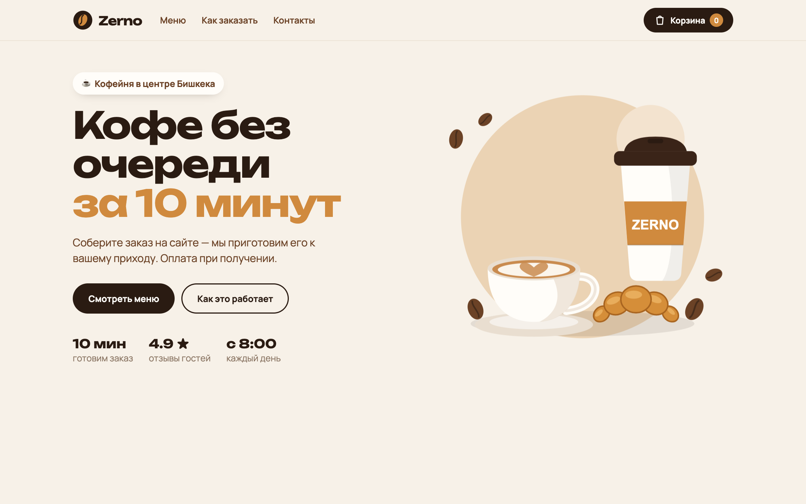

### 1.1 Основа стилей · *повторяем: переменные CSS, box-sizing*
**Что:** в `css/style.css` уже есть `:root` с цветами и шрифтами — используйте только их (`var(--caramel)`).
- `*, *::before, *::after` — `box-sizing: border-box`.
- `body`: без отступов, шрифт `var(--font-body)`, цвет `var(--espresso)`, фон `var(--cream)`, `line-height: 1.5`.
- `[hidden] { display: none !important; }` — атрибут `hidden` должен побеждать любой `display`.
- `img`: `display: block`, `max-width: 100%`.
- `.container`: ширина `min(1180px, 100% - 40px)`, по центру (`margin-inline: auto`).

**Зачем:** один раз задали правила — дальше вся страница выглядит одинаково.

### 1.2 Шапка · *повторяем: семантика, flex*
**Что:** `header.header` → `.container.header__inner`:
- логотип — ссылка `.logo` на `#top`: картинка `assets/img/logo.svg` (`.logo__icon`) и текст `.logo__text` «Zerno»;
- `nav.nav` — три ссылки `.nav__link`: «Меню» (`#menu`), «Как заказать» (`#how`), «Контакты» (`#contacts`);
- кнопка `.cart-button` (`type="button"`, `aria-label="Открыть корзину"`): иконка `assets/img/icon-bag.svg`, текст «Корзина», счётчик `.cart-button__count` «0».

**CSS:** шапка прилипает сверху (`position: sticky; top: 0; z-index: 10`), полупрозрачный фон + `backdrop-filter: blur(12px)`, линия снизу. Внутри — flex по центру высотой 72px, `gap: 32px`. Меню отодвигает кнопку вправо: `margin-right: auto` у `.nav`. Логотип — шрифт `var(--font-head)` 22px. Кнопка корзины — тёмная «таблетка» (`border-radius: 999px`), счётчик — карамельный кружок.

### 1.3 Первый экран · *повторяем: grid, clamp, кнопки*
**Что:** `main` → `section.hero#top` → `.container.hero__inner`: слева `.hero__text`, справа картинка `.hero__art` (`assets/img/hero.svg`).
- `.hero__badge` «☕ Кофейня в центре Бишкека»;
- `h1.hero__title` «Кофе без очереди» + `span.hero__accent` «за 10 минут» (с новой строки, карамельный);
- `.hero__lead` — одно предложение о сервисе;
- две кнопки-ссылки: `.button` «Смотреть меню» (`#menu`) и `.button.button--ghost` «Как это работает» (`#how`);
- `ul.hero__facts` — три факта: **10 мин** готовим заказ · **4.9 ★** отзывы · **с 8:00** каждый день.

**CSS:** `.hero__inner` — grid в две колонки, по центру по вертикали. Заголовок — `font-size: clamp(36px, 5.6vw, 66px)`, плотный `line-height: 1.05`. `.button` — общий блок кнопки: тёмная таблетка, при наведении приподнимается (`transform: translateY(-2px)`) и даёт тень, `transition`. `.button--ghost` — прозрачная с рамкой. Картинка плавно «парит»: `@keyframes float` (сдвиг на −12px), 6 секунд, бесконечно.

**Проверка:** сравните с фото. Шапка при прокрутке остаётся сверху. Кнопки приподнимаются при наведении.

**Коммит:** «Этап 1: шапка и первый экран».

---

## Этап 2 · Меню, «Как заказать», подвал (1:20–2:20) · HTML + CSS

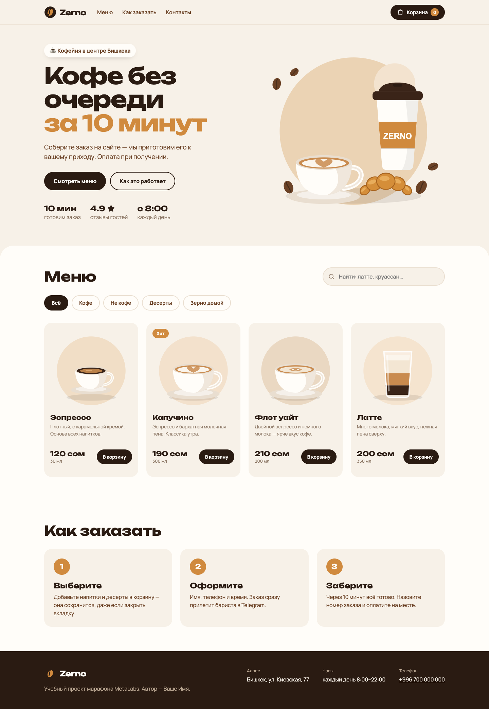

### 2.1 Меню (пока вручную) · *повторяем: формы, position, grid*
**Что:** `section.menu#menu` → `.container`:
- `.menu__head`: `h2.section-title` «Меню» и поиск `label.search` — иконка `assets/img/icon-search.svg` (`.search__icon`) + `input.search__input` (`type="search"`, placeholder «Найти: латте, круассан…»);
- `.tabs` — пять кнопок `.tabs__button`: Всё, Кофе, Не кофе, Десерты, Зерно домой. У первой — класс `is-active`;
- `ul.menu__grid` — **4 карточки вручную** (данные возьмите из `products.js`). Карточка `li.card`: `.card__badge` (только у «Хит»), картинка `.card__image`, `h3.card__title`, `p.card__text`, внизу `.card__bottom`: `p.card__price` («190 сом» + `span.card__size` «300 мл») и кнопка `.button.card__add` «В корзину»;
- `p.menu__empty` «Ничего не нашли…» с атрибутом `hidden`.

**CSS:** секция светлая (`var(--paper)`) со скруглёнными верхними углами 40px. Поиск — иконка внутри поля (`position: absolute` у иконки, `relative` у `.search`, отступ слева у поля). Вкладки — таблетки в ряд, активная — тёмная. Сетка — `grid-template-columns: repeat(auto-fill, minmax(250px, 1fr))`, `gap: 24px`. Карточка — колонка (flex), бейдж в углу (`position: absolute`), картинка квадратная (`aspect-ratio: 1`), текст растягивается (`flex-grow: 1`), чтобы кнопки стояли на одной линии. При наведении карточка поднимается, картинка чуть увеличивается и поворачивается.

### 2.2 «Как заказать» и подвал · *повторяем: ol, grid, flex-wrap*
**Что:** `section.how#how`: заголовок и `ol.how__list` из трёх шагов (`.how__num` 1/2/3, `h3.how__title`, `p.how__text`): Выберите → Оформите → Заберите.
`footer.footer#contacts`: светлый логотип (`.logo.logo--light`), подпись «Учебный проект марафона MetaLabs. Автор — **ваше имя**», список контактов (адрес, часы, телефон-ссылка `tel:`).

**CSS:** три карточки шагов в ряд (`grid`, 3 колонки), номер — карамельный круг. Подвал тёмный, контакты — flex с переносом.

**Проверка:** сравните с фото. Карточки одной высоты, кнопки на одной линии.

**Коммит:** «Этап 2: меню, шаги, подвал».

---

**☕ Перерыв 15 минут**

---

## Этап 3 · Корзина (вёрстка) и телефон (2:35–3:15) · HTML + CSS

| Корзина | Форма | Готово | Телефон |
|---|---|---|---|
| 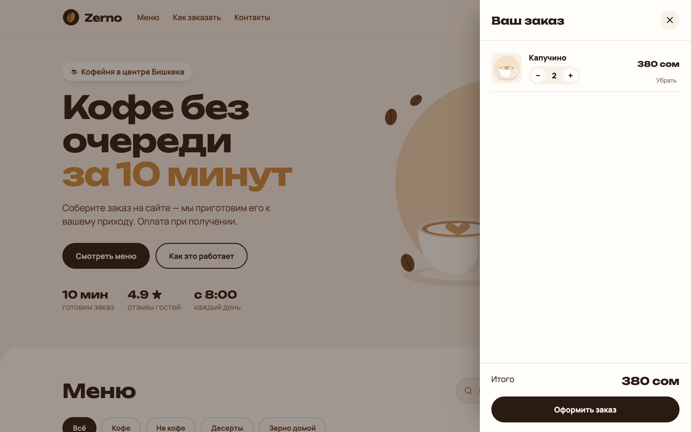 | 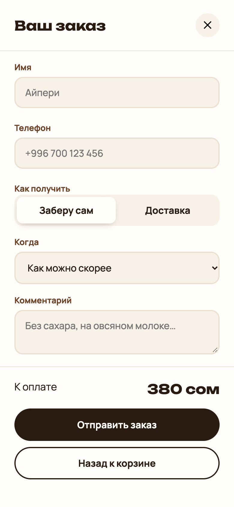 | 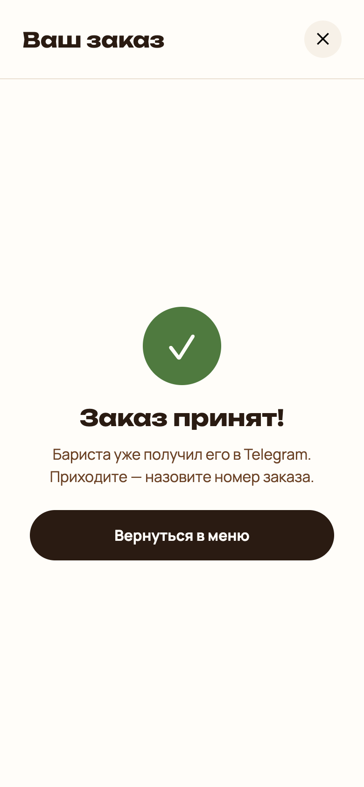 | 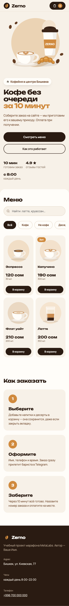 |

### 3.1 Выезжающая панель · *повторяем: position: fixed, transform, data-атрибуты*
**Что:** после подвала:
- `div.overlay` с `hidden` — затемнение страницы;
- `aside.cart` (`aria-label="Корзина"`, `data-view="list"`): шапка `.cart__head` (заголовок «Ваш заказ», кнопка `.cart__close` «✕») и **три вида** `.cart__view`:
  - `.cart__view--list`: `ul.cart__list` (пока одна строка вручную), `.cart__empty` (картинка + «Корзина пуста…»), низ `.cart__foot` — «Итого» `b.cart__sum` и кнопка `.cart__next` «Оформить заказ»;
  - `form.cart__view--form.order` (`novalidate`): поля «Имя», «Телефон» (`type="tel"`), переключатель «Заберу сам / Доставка» (две `radio name="delivery"`), поле «Адрес» `.order__address` с `hidden`, `select name="time"`, `textarea name="comment"`, низ: «К оплате», кнопки `.order__submit` «Отправить заказ» и `.order__back` «Назад к корзине». У каждого поля — `label.field` → `span.field__label`, поле `.field__input`, `span.field__error`;
  - `.cart__view--done.done`: значок `.done__icon` «✓», `h3.done__title`, `p.done__text`, ссылка `.done__telegram` (`hidden`), кнопка `.done__again` «Вернуться в меню»;
- `div.toast` (`role="status"`) — всплывающее сообщение.

**CSS:** панель `position: fixed` справа, ширина `min(440px, 100%)`, на всю высоту; спрятана сдвигом `transform: translateX(100%)` + `visibility: hidden`; класс `.is-open` возвращает её на место. Виды: все `.cart__view` скрыты, показываем один по атрибуту: `.cart[data-view="form"] .cart__view--form { display: flex }` (и так для list и done). Строка корзины — grid `64px 1fr auto`. Кнопки «− 2 +» — `.qty`. Переключатель — радио спрятаны, выбранный вариант (`input:checked + span`) — белая плашка. Ошибка поля — класс `.is-invalid` на `.field` красит рамку.

**Проверка:** временно добавьте `aside` класс `is-open` — панель видна. Поменяйте `data-view` на `form`, потом `done` — сверьте с фото. **Уберите `is-open` обратно.**

### 3.2 Телефон · *повторяем: @media*
**Что:** два медиазапроса:
- до 900px: первый экран в одну колонку, картинка сверху (`order: -1`), шаги — в колонку;
- до 640px: прячем меню и слово «Корзина» в кнопке, карточки — по 2 в ряд, описание карточки скрыть, кнопки на всю ширину карточки.

**Проверка:** F12 → значок телефона (Device Toolbar) → ширина 390px. Сравните с фото «Телефон». Нет горизонтальной прокрутки.

**Коммит:** «Этап 3: корзина и адаптив».

---

## Этап 4 · Меню из данных (3:15–4:05) · JavaScript

| Категория «Десерты» | Поиск «латте» на телефоне |
|---|---|
| 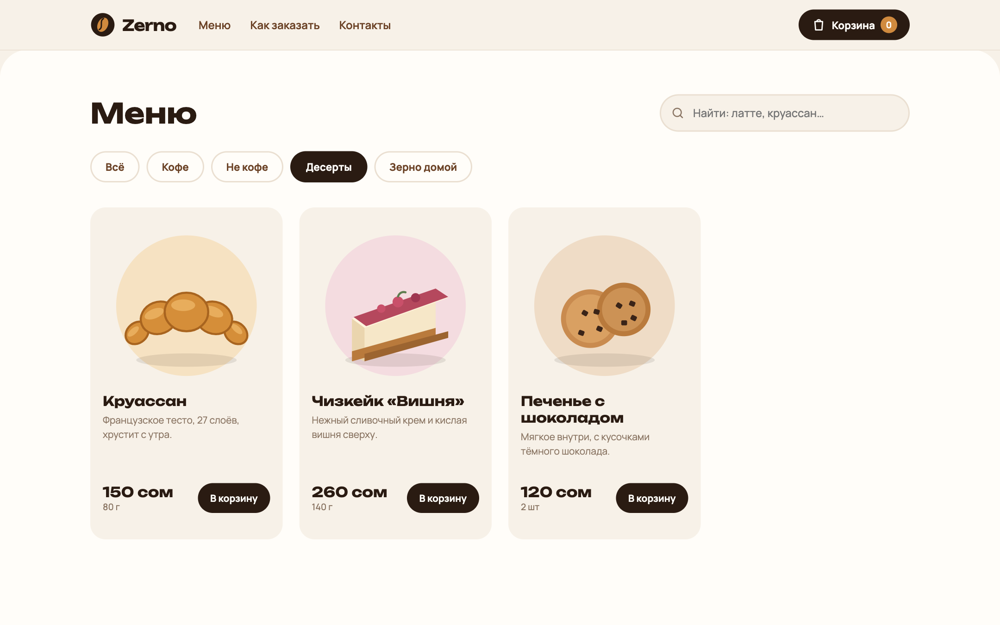 | 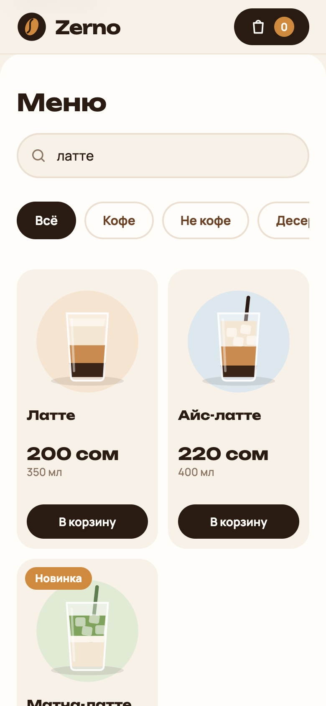 |

### 4.1 Карточки из массива · *повторяем: модули (урок 21), map/join (12), создание элементов (18)*
**Что:**
- в HTML удалите ручные вкладки и карточки — оставьте пустые `div.tabs` и `ul.menu__grid`;
- в `js/app.js`: `import { CATEGORIES, PRODUCTS, SHOP } from "./products.js"`;
- функция `money(число)` → «1 370 сом» (`toLocaleString("ru-RU")` + `SHOP.currency`);
- `renderTabs()` — кнопки из `CATEGORIES`, у каждой `data-category="id"`, активной — `is-active`;
- `cardHTML(product)` — строка с разметкой одной карточки (как в этапе 2, данные — из объекта, у кнопки `data-id`). Бейдж — только если есть `product.badge`;
- `renderMenu()` — `grid.innerHTML = список.map(cardHTML).join("")`.

### 4.2 Фильтр и поиск · *повторяем: filter (12), строки (8), события (16)*
**Что:**
- переменная `activeCategory = "all"`;
- `renderMenu()` берёт товары, у которых категория подходит (или выбрано «all») **и** название или описание содержит текст поиска (`toLowerCase`, `includes`, `trim`);
- нет ни одного — показываем `.menu__empty` (`hidden = false`);
- клик по `.tabs` — **один обработчик на весь блок**: `event.target.closest(".tabs__button")`, берём `dataset.category`, перерисовываем вкладки и меню;
- `input` в поиске → `renderMenu`.

**Проверка:** 14 карточек. «Десерты» → 3. Поиск «латте» → Латте, Айс-латте, Матча-латте. «пицца» → «Ничего не нашли». В консоли нет ошибок.

**Коммит:** «Этап 4: меню из данных, фильтр, поиск».

---

## Этап 5 · Корзина работает (4:05–5:00) · JavaScript

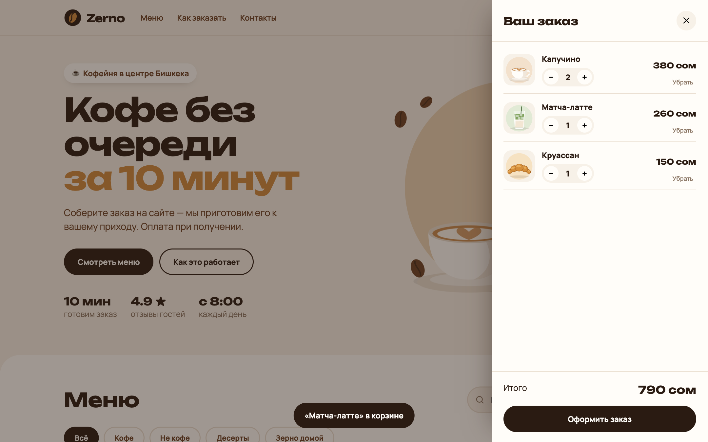

### 5.1 Данные корзины — `js/cart.js` · *повторяем: объекты (11), reduce (12), localStorage (24)*
**Что:** отдельный модуль только с данными (без DOM):
- состояние — объект `{ "2": 1, "10": 3 }` (id → количество), ключ хранилища `"zerno-cart"`;
- `load()` — читает из `localStorage` (`JSON.parse` в `try…catch`: мусор → пустая корзина); `save()` — записывает;
- `export`: `add(id)`, `change(id, ±1)` (до нуля — удалить, не больше 20), `remove(id)`, `clear()`;
- `items()` — массив строк `{ product, qty, sum }` (товар находим в `PRODUCTS` по id); `count()` и `total()` — через `reduce`.

### 5.2 Панель и кнопки · *повторяем: classList, делегирование, dataset*
**Что:** в `app.js` — `import * as cart from "./cart.js"`.
- `openCart()` / `closeCart()`: класс `is-open`, показать/спрятать `.overlay`, у `body` класс `is-locked` (страница не прокручивается под панелью). Закрывают: «✕», клик по затемнению, клавиша Escape;
- `renderCart()`: строки корзины (картинка, название, «− количество +», сумма, «Убрать»), класс `is-empty` у `.cart`, если пусто, итог во **всех** `.cart__sum`, число на кнопке в шапке;
- клик «В корзину» — делегирование на `.menu__grid`: `cart.add`, `renderCart`, сообщение `toast("«Капучино» в корзине")` на 1,8 секунды, счётчик «подпрыгивает» (класс `is-bump`);
- клики «−», «+», «Убрать» — делегирование на `.cart__list`, кнопкам дайте `data-id` и `data-delta`.

**Проверка:** 2 × Капучино + Круассан + Матча-латте = **790 сом**, на кнопке «4». F5 — корзина на месте. «−» до нуля убирает товар. Пустая корзина — картинка и «Корзина пуста».

**Коммит:** «Этап 5: корзина и localStorage».

---

## Этап 6 · Заказ в Telegram (5:00–5:35) · JavaScript + бот

| Ошибки формы | Заказ принят | Бот не настроен |
|---|---|---|
| 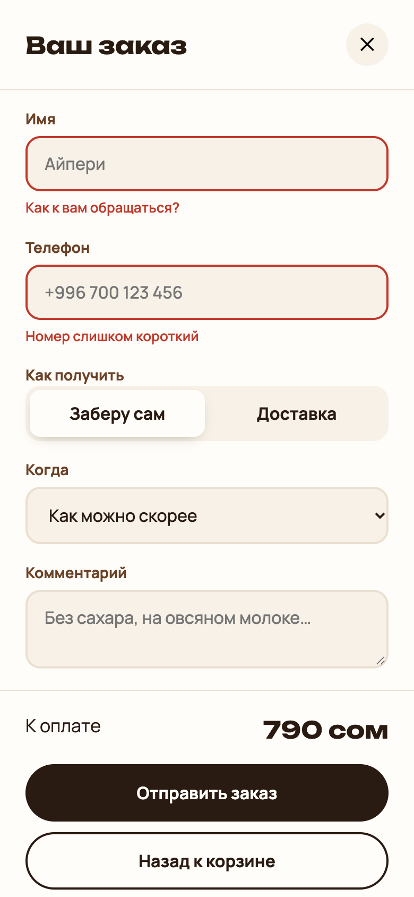 | 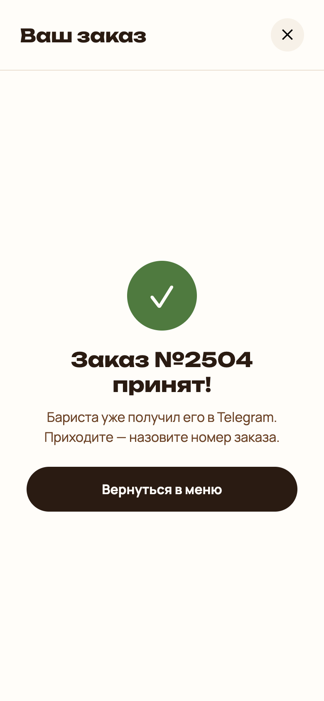 | 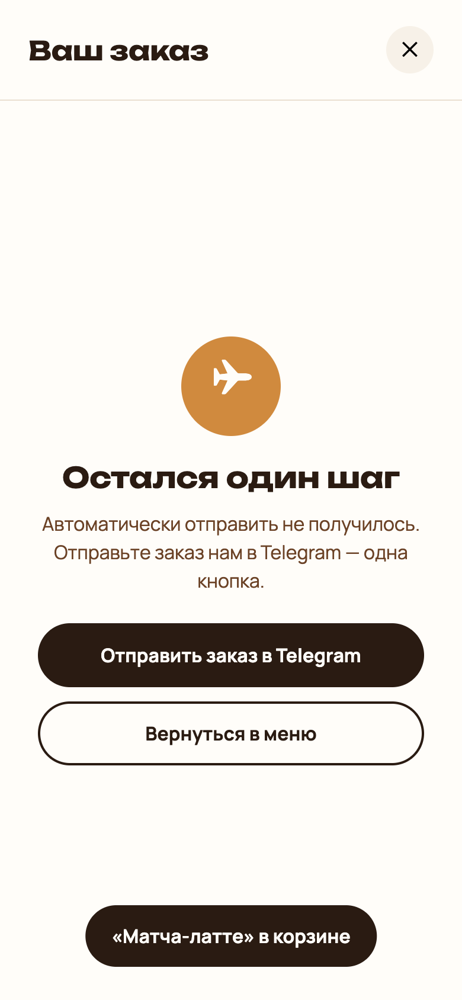 |

### 6.1 Свой бот (5 минут)
1. В Telegram откройте **@BotFather** → `/newbot` → имя и ник бота → получите **токен** (`123456:AA…`).
2. Напишите своему боту любое сообщение (иначе он не сможет написать вам).
3. Узнайте свой **chat id**: бот **@userinfobot** → Start → строка `Id` — это вы. ⚠️ Число до двоеточия в токене — id **бота**, а не ваш: с ним Telegram ответит «the bot can't send messages to the bot».
4. Скопируйте `.env.example` в `.env` и вставьте токен и chat id. Перезапустите `npm start`.

⚠️ **Токен — это пароль бота.** Только в `.env` (он в `.gitignore`) и в настройках Vercel. Никогда — в `app.js`: код страницы видит любой через F12.

### 6.2 Форма · *повторяем: формы (урок 17), FormData, условия*
**Что:**
- «Оформить заказ» → `data-view="form"`, «Назад к корзине» → `"list"`;
- выбрали «Доставка» → показываем поле адреса (событие `change` на форме, `event.target.name === "delivery"`);
- `validate(data)`: имя от 2 символов («Как к вам обращаться?»), в телефоне от 9 цифр (`replace(/\D/g, "")`, «Номер слишком короткий»), при доставке — адрес от 5 символов («Куда привезти?»). Ошибка → `.is-invalid` у `.field` и текст в `.field__error`.

### 6.3 Отправка · *повторяем: fetch и JSON (23), async/await (22)*
**Что:** на `submit` (`preventDefault`):
- данные формы: `Object.fromEntries(new FormData(form))`, у строк — `trim`;
- кнопка на время отправки: `disabled` и текст «Отправляем…»;
- `fetch("/api/order", { method: "POST", headers: { "Content-Type": "application/json" }, body })`, где в `body` — `{ customer: данные формы, items: [{ id, qty }] }`. **Цены не отправляем** — сервер считает сам из `products.js`, подделать нельзя;
- ответ `ok` → `data-view="done"`, заголовок «Заказ №… принят!», корзину очистить, форму сбросить;
- ошибка (бот не настроен, нет сети) → тоже «done», но заголовок «Остался один шаг», у `.done` класс `done--fallback` и видимая ссылка `.done__telegram`: `https://t.me/` + `SHOP.telegram` + `?text=` + `encodeURIComponent(текст заказа)` — покупатель отправит заказ сам.

**Проверка:** пустая форма → три красных подсказки. Заполненная → в ваш Telegram приходит:
```
☕ Новый заказ №2504
👤 Айпери · +996 700 123 456
🚶 Заберёт сам
⏰ как можно скорее

2 × Капучино — 380 сом
1 × Матча-латте — 260 сом
1 × Круассан — 150 сом

Итого: 790 сом
```
Удалите `.env` и повторите — экран «Остался один шаг» с кнопкой Telegram.

**Коммит:** «Этап 6: заказ в Telegram».

---

## Этап 7 · В интернет и в портфолио (5:35–6:00)

1. **GitHub:** новый репозиторий `zerno-shop` → `git remote add origin …` → `git push -u origin main` (урок Git).
2. **Vercel:** vercel.com → Add New → Project → Import ваш репозиторий → Framework: **Other** → в **Environment Variables** добавьте `TELEGRAM_BOT_TOKEN` и `TELEGRAM_CHAT_ID` → Deploy.
3. Откройте ссылку `…vercel.app`, оформите заказ с телефона — он пришёл в Telegram? 🎉
4. **README.md**: заполните шаблон (ссылка на сайт, скриншот, что умеет, стек, «что я сделал сам»).
5. В подвале — ваше имя. Ссылку — в резюме и в профиль GitHub.

**Своя тема** (если осталось время или дома): `products.js` — название, контакты, товары; `:root` — цвета; `assets/img` — свои картинки (квадратные, светлый фон); `hero.svg` — свою иллюстрацию или фото; `<title>` и тексты первого экрана.

---

## Чек-лист готового проекта
- [ ] Шапка прилипает, кнопки и карточки оживают при наведении
- [ ] 14 товаров из данных, фильтр и поиск, «Ничего не нашли»
- [ ] Корзина: +/−, «Убрать», итог, переживает F5, пустое состояние
- [ ] Форма: подсказки ошибок, адрес только для доставки
- [ ] Заказ приходит в Telegram; без бота — запасная кнопка
- [ ] На телефоне всё помещается, нет горизонтальной прокрутки
- [ ] Сайт на Vercel, токен — только в настройках Vercel
- [ ] README со ссылкой и скриншотом, ваше имя в подвале
