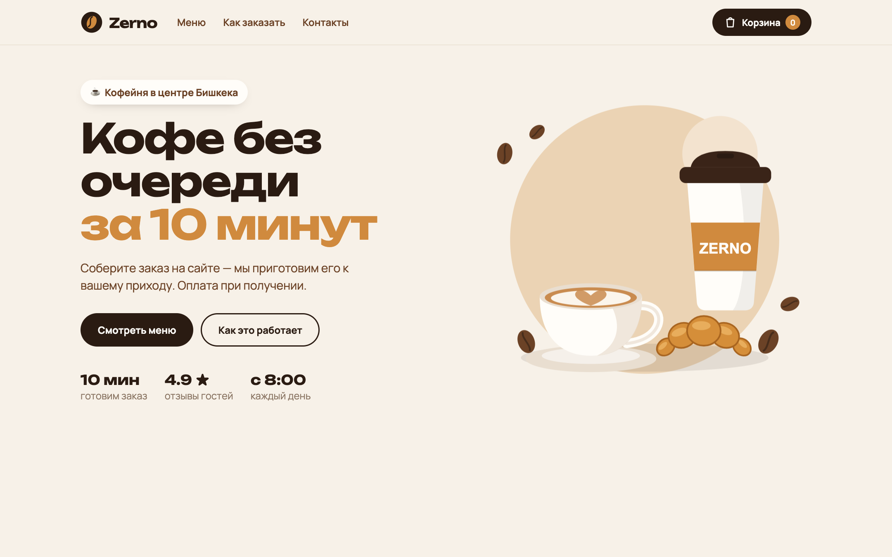

# Zerno — кофейня с заказом онлайн

Одностраничный магазин кофейни: меню с поиском и фильтром, корзина с сохранением, оформление заказа — **заказ приходит в Telegram**.

🔗 **Сайт:** https://ваш-проект.vercel.app


<!-- замените на скриншот своего сайта -->

## Что умеет
- Меню из данных: 14 товаров, категории, поиск
- Корзина: +/−, удаление, итог, сохраняется после перезагрузки (localStorage)
- Форма заказа с проверкой полей, доставка или самовывоз
- Отправка заказа в Telegram через серверную функцию (токен бота не попадает в браузер, цены считает сервер)
- Запасной вариант: если бот недоступен — заказ отправляется кнопкой в Telegram
- Адаптивная вёрстка: телефон, планшет, компьютер

## Стек
HTML · CSS (Grid, Flexbox, переменные, анимации) · JavaScript (модули, fetch, localStorage) · Vercel Functions · Telegram Bot API

## Запуск у себя
```bash
npm start
```
Откройте http://localhost:3000. Для отправки в Telegram скопируйте `.env.example` в `.env` и вставьте токен бота и chat id.

## Что я сделал сам
Вёрстка всех экранов, каталог и корзина на JavaScript, форма и отправка заказа, публикация на Vercel.
Сделано на марафоне MetaLabs за 6 часов.
